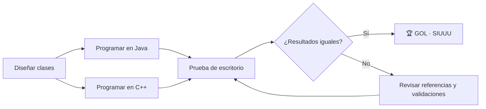

<a name="inicio"></a>

<div align="center">


# 🐐 TALLER BIBLIOTECA & APE 4 · EL GOAT DE LOS OBJETOS 🐐


</div>

<p align="center">
  <strong>🏟️ EL ESTADIO DEL CÓDIGO · FACULTAD DE INGENIERÍA EN SISTEMAS, ELECTRÓNICA E INDUSTRIAL</strong><br>
  <em>«Del barrio de Madeira a la cima del mundo: el talento se entrena, y las clases también.»</em>
</p>

<div align="center">


<br>


<br><br>

**Bienvenido al estadio, crack.**<br>
Este repositorio contiene la solución de la **APE 4: Integración de clases, objetos y métodos** y del **Taller Biblioteca**, con 5 ejercicios resueltos en **Java** y en **C++**.<br>
Como en la carrera del bicho, cada ejercicio es un club distinto: se entrena con disciplina, se juega con clases y objetos, y se gana con su prueba de escritorio.

**Un GOAT. Cinco clubes. Dos lenguajes. Cero errores de compilación.**

[🏟️ Expediente](#expediente) ·
[🐐 El GOAT](#goat) ·
[⚽ Carrera](#carrera) ·
[📋 Tácticas](#tacticas) ·
[🗂️ Vestuario](#vestuario) ·
[▶️ Cómo jugar](#como-jugar) ·
[🏆 Vitrina](#vitrina)

</div>

---

<a name="expediente"></a>

## 🏟️ El expediente · ¿De qué trata este repositorio?

Este repositorio reúne los 5 ejercicios de la APE 4. Con ellos se practica la integración de **clases, objetos, atributos y métodos** con distintos tipos de retorno (`void`, `double`, `boolean`, `String`), usando objetos como **atributos** de otras clases y como **parámetros** de métodos.

Como en cualquier carrera de leyenda, el orden importa: se empieza con un objeto dentro de otro (Libro y Autor) y se termina con tres clases jugando como un solo equipo (el Taller Biblioteca).

<div align="center">

</div>

### 🎯 Objetivos de la temporada

- **Diseñar clases sólidas**: constructores, atributos privados y métodos especializados.
- **Usar objetos como atributos**: un `Libro` que tiene dentro un `Autor`.
- **Usar objetos como parámetros**: `Producto` y `Venta`, `Cuenta` y `Cuenta`, `Usuario`, `Libro` y `Prestamo`.
- **Dominar los tipos de retorno**: `void`, `double`, `boolean` y `String`, cada uno en su posición.
- **Rendir igual en cualquier liga**: obtener los mismos resultados en **Java** y en **C++**.

> [!TIP]
> **Lema del vestuario:** «El talento sin trabajo no es nada: revisa tu prueba de escritorio antes de salir a la cancha».

---

<a name="goat"></a>

## 🐐 El GOAT · Integrante y rol

Este partido se juega en solitario. Un solo jugador, la camiseta número 7 y todos los ejercicios:

<div align="center">

</div>

| N.º | Integrante | Posición en la cancha | Componentes |
| :---: | :--- | :--- | :--- |
| **7** | **PAREDES ACOSTA DERECK SHAIR** | **El GOAT del Código · Analizar, diseñar, programar y probar** | Ejercicios del 1 al 5 en **Java** y **C++**, con sus pruebas de escritorio. |

| Dato | Detalle |
| :--- | :--- |
| **Asignatura** | Algoritmos y Lógica de Programación |
| **Carrera** | Software |
| **Nivel y paralelo** | Primero - B |
| **Docente** | Ing. José Ruben Caizabuano, M.Sc. |
| **Universidad** | Universidad Técnica de Ambato |

---

<a name="carrera"></a>

## ⚽ La carrera · Los 5 ejercicios

Cada ejercicio es una etapa en la carrera de la leyenda:

| Etapa | Club | Ejercicio | Jugada aplicada | Clases en la cancha |
| :---: | :--- | :--- | :--- | :--- |
| 🟢 **1** | Lisboa | **Libro y Autor** | Objeto como atributo | `Autor`, `Libro` |
| 🔴 **2** | Mánchester | **Rectángulo** | Métodos con distintos tipos de retorno | `Rectangulo` |
| ⚪ **3** | Madrid | **Producto y Venta** | Objeto como parámetro | `Producto`, `Venta` |
| ⚫ **4** | Turín | **Transferencias** | Objeto como parámetro y validación de saldo | `Cuenta` |
| 🟡 **5** | Riad | **Taller Biblioteca** | Colaboración entre varias clases | `Usuario`, `Libro`, `Prestamo` |

### ⚽ Primera etapa · Los inicios

**🟢 Ejercicio 1 · Libro y Autor.** La clase `Libro` tiene un atributo de tipo `Autor`. Un objeto vive dentro de otro, como el jugador joven que llega al primer equipo.

**🔴 Ejercicio 2 · Rectángulo.** Una sola clase con métodos que devuelven tipos distintos: `double` para los cálculos, `boolean` para las comprobaciones, `String` para las descripciones y `void` para mostrar datos.

### ⚽ Segunda etapa · La consagración

**⚪ Ejercicio 3 · Producto y Venta.** La `Venta` recibe un `Producto` como parámetro, valida que haya stock suficiente y actualiza el inventario del objeto original.

**⚫ Ejercicio 4 · Transferencias.** Una `Cuenta` recibe otra `Cuenta` como parámetro para transferirle dinero, solo si el saldo alcanza.

### 🏆 Tercera etapa · La leyenda

**🟡 Ejercicio 5 · Taller Biblioteca.** `Usuario`, `Libro` y `Prestamo` colaboran para registrar un préstamo, validando antes que el libro esté disponible.

> [!IMPORTANT]
> **Regla de oro del GOAT:** cada ejercicio tiene su versión en **Java** y su versión en **C++**, y ambas deben dar los mismos resultados en la prueba de escritorio.

---

<a name="tacticas"></a>

## 📋 Las tácticas · Java vs C++

Dos ligas distintas, el mismo nivel de juego:

| Jugada | ☕ Java | ⚙️ C++ |
| :--- | :--- | :--- |
| Crear un objeto | `Libro libro = new Libro(...);` | `Libro libro(...);` |
| Objeto como atributo | `private Autor autor;` | `Autor autor;` |
| Objeto como parámetro que se modifica | Se pasa la referencia del objeto | Se usa `&` (`void vender(Producto& p)`) |
| Encapsulamiento | `private` + getters y setters | `private:` + getters y setters |
| Mostrar resultados | `System.out.println` / `printf` | `cout << ... << endl` |

> [!NOTE]
> En C++, si un objeto se pasa **sin** `&`, el método trabaja con una **copia**: el stock, el saldo o la disponibilidad no cambian en el objeto original. Es la tarjeta roja más común del torneo.

### 🏋️ Metodología de entrenamiento

1. **Diseño de clases:** constructores, modificadores de acceso y tipos de retorno.
2. **Paso de objetos:** referencias en Java y `&` en C++ para modificar el estado original.
3. **Validaciones:** stock en las ventas, saldo en las transferencias y disponibilidad de los libros.
4. **Prueba de escritorio:** seguir cada variable paso a paso y comparar Java con C++.



---

<a name="vestuario"></a>

## 🗂️ El vestuario · Estructura del repositorio

```text
APE4-Clases-y-Objetos/
┣ 📂 Ejercicio 1 - Libro y Autor/
┃ ┣ 📂 Java/
┃ ┗ 📂 C++/
┣ 📂 Ejercicio 2 - Rectangulo/
┃ ┣ 📂 Java/
┃ ┗ 📂 C++/
┣ 📂 Ejercicio 3 - Producto y Venta/
┃ ┣ 📂 Java/
┃ ┗ 📂 C++/
┣ 📂 Ejercicio 4 - Transferencias/
┃ ┣ 📂 Java/
┃ ┗ 📂 C++/
┣ 📂 Ejercicio 5 - Taller Biblioteca/
┃ ┣ 📂 Java/
┃ ┗ 📂 C++/
┗ 📜 README.md
```

| Herramienta | Detalle |
| :--- | :--- |
| **Java** | Java Development Kit (JDK) |
| **C++** | Compilador `g++` (GCC) |
| **IDEs** | NetBeans, IntelliJ IDEA o Visual Studio Code |

---

<a name="como-jugar"></a>

## ▶️ Cómo jugar · Compilar y ejecutar

Cada ejercicio se ejecuta desde su propia carpeta. Reemplaza `Principal` por el nombre de tu clase con el `main`:

**☕ Java**

```bash
cd "Ejercicio 1 - Libro y Autor/Java"
javac *.java
java Principal
```

**⚙️ C++**

```bash
cd "Ejercicio 1 - Libro y Autor/C++"
g++ *.cpp -o programa
./programa
```

> [!IMPORTANT]
> - En Java, cada archivo debe llamarse igual que su clase pública.
> - En Windows, ejecuta el programa de C++ con `programa.exe`.

---

<a name="vitrina"></a>

## 🏆 La vitrina · Fin del partido

<div align="center">


*«El partido terminó, mi crack. El marcador quedó 5 a 0 y el trofeo ya está en la vitrina. Ahora, a entrenar para la próxima APE.»*

Si llegaste hasta aquí, el estadio entero te aplaude. ⚽🐐🏆🇵🇹

[⬆️ Volver al inicio](#inicio)


</div>
