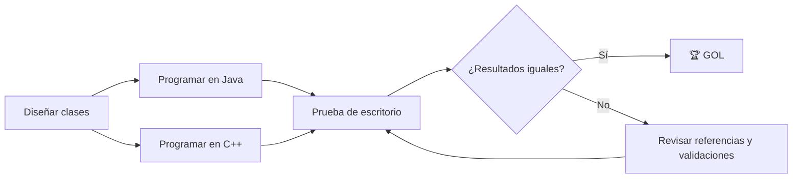

<a name="inicio"></a>

<div align="center">


# ⚽ TALLER BIBLIOTECA & APE 4 · EL CAMPEÓN DE LOS OBJETOS 🏆


</div>

<p align="center">
  <strong>🏟️ EL ESTADIO DEL CÓDIGO · FACULTAD DE INGENIERÍA EN SISTEMAS, ELECTRÓNICA E INDUSTRIAL</strong><br>
  <em>«El talento abre el partido, pero la disciplina en cada clase, método y objeto es la que levanta el trofeo.»</em>
</p>

<div align="center">


<br>


<br><br>

**Bienvenido al estadio, crack.**<br>
Este repositorio documenta la **APE 4: Integración de clases, objetos y métodos** y el **Taller Biblioteca**, con implementaciones en **Java** y en **C++**.<br>
Aquí se diseñan clases con atributos complejos, se hace colaborar a los objetos como un equipo bien entrenado y cada línea se valida con pruebas de escritorio.

**Un goleador. Dos lenguajes. Cinco goles. Cero errores de compilación.**

[🏟️ Expediente](#expediente) ·
[⚽ Goleador](#goleador) ·
[🥅 Partidos](#partidos) ·
[📋 Tácticas](#tacticas) ·
[🏋️ Entrenamiento](#entrenamiento) ·
[🧰 Vestuario](#vestuario) ·
[▶️ Cómo jugar](#como-jugar) ·
[🏆 Celebración](#celebracion)

</div>

---

<a name="expediente"></a>

## 🏟️ El expediente · Sobre la APE 4

Este repositorio reúne cinco prácticas de la asignatura **Algoritmos y Lógica de Programación**. El objetivo es integrar los conceptos de **clases, objetos, atributos y métodos** con distintos tipos de retorno (`void`, `double`, `boolean`, `String`), usando objetos como **atributos** de otras clases y como **parámetros** de métodos.

<div align="center">

</div>

### 🎯 Objetivos del torneo

- **Diseñar clases sólidas**, con constructores, atributos privados y métodos especializados.
- **Jugar en equipo**: usar objetos como atributos (`Libro` ↔ `Autor`) y como parámetros (`Producto` ↔ `Venta`, `Cuenta` ↔ `Cuenta`, `Usuario` ↔ `Libro` ↔ `Prestamo`).
- **Dominar los tipos de retorno**: aplicar `void`, `double`, `boolean` y `String` según la tarea de cada método.
- **Rendir igual en cualquier cancha**: obtener los mismos resultados al ejecutar en **Java** y en **C++**.

> [!TIP]
> **Lema del vestuario:** «Un buen diseño orientado a objetos es como un buen entrenamiento: no se nota hasta el día del examen, y ese día lo es todo».

---

<a name="goleador"></a>

## ⚽ El goleador · Integrante y rol

Este partido se juega con un solo jugador en la cancha, y lleva la camiseta número 7:

<div align="center">

</div>

| N.º | Integrante | Posición en la cancha | Componentes |
| :---: | :--- | :--- | :--- |
| **7** | **PAREDES ACOSTA DERECK SHAIR** | **Delantero estrella · Analizar, diseñar, programar y probar** | Los 5 ejercicios en **Java** y **C++**, con sus pruebas de escritorio. |

| Dato | Detalle |
| :--- | :--- |
| **Asignatura** | Algoritmos y Lógica de Programación |
| **Nivel y paralelo** | Primero - B |
| **Docente** | Ing. José Ruben Caizabuano, M.Sc. |
| **Universidad** | Universidad Técnica de Ambato |

---

<a name="partidos"></a>

## 🥅 Los partidos · Resumen de ejercicios

El torneo se divide en cinco partidos, y cada uno termina en gol:

| Partido | Ejercicio | Jugada aplicada | Clases en la cancha |
| :---: | :--- | :--- | :--- |
| ⚽ **01** | 📖 **Libro y Autor** | Objeto como atributo | `Autor`, `Libro` |
| ⚽ **02** | 📐 **Rectángulo** | Métodos con distintos tipos de retorno | `Rectangulo` |
| ⚽ **03** | 🛒 **Producto y Venta** | Objeto como parámetro | `Producto`, `Venta` |
| ⚽ **04** | 💳 **Transferencias** | Objeto como parámetro y validación de saldo | `Cuenta` |
| 🏆 **05** | 📚 **Biblioteca (Taller)** | Colaboración entre varias clases | `Usuario`, `Libro`, `Prestamo` |

### ⚽ Primer tiempo · Fundamentos

**01 · Libro y Autor.** La clase `Libro` tiene un atributo de tipo `Autor`: un objeto vive dentro de otro, como el capitán dentro del once titular.

**02 · Rectángulo.** Una sola clase con métodos que devuelven cosas distintas: `double` para el área y el perímetro, `boolean` para saber si es un cuadrado, `String` para describirlo y `void` para mostrar los datos.

### ⚽ Segundo tiempo · Jugadas en equipo

**03 · Producto y Venta.** La `Venta` recibe un `Producto` como parámetro, valida que haya stock suficiente y actualiza el inventario original.

**04 · Transferencias.** Una `Cuenta` recibe otra `Cuenta` como parámetro para transferirle dinero, siempre que el saldo alcance.

### 🏆 La final · Taller Biblioteca

**05 · Biblioteca.** `Usuario`, `Libro` y `Prestamo` colaboran para registrar un préstamo solo si el libro está disponible, y cambian su estado al prestarlo.

> [!IMPORTANT]
> **Regla de oro del equipo:** cada ejercicio tiene su versión en **Java** y su versión en **C++**, y ambas deben dar los mismos resultados en la prueba de escritorio.

---

<a name="tacticas"></a>

## 📋 Las tácticas · Java vs C++

Dos canchas distintas, la misma estrategia:

| Jugada | ☕ Java | ⚙️ C++ |
| :--- | :--- | :--- |
| Crear un objeto | `Libro l = new Libro(...);` | `Libro l(...);` |
| Objeto como atributo | `private Autor autor;` | `Autor autor;` |
| Objeto como parámetro que se modifica | Se pasa la referencia del objeto: los cambios afectan al original | Se usa referencia `&` (`void vender(Producto& p)`) para modificar el original |
| Encapsulamiento | `private` + getters y setters | `private:` + getters y setters |
| Mostrar resultados | `System.out.println` / `printf` | `cout << ... << endl` |

> [!NOTE]
> En C++, si un objeto se pasa **sin** `&`, el método trabaja con una **copia**, y los cambios (stock, saldo o disponibilidad) no se reflejan en el original. Ese es el error más común del torneo.

---

<a name="entrenamiento"></a>

## 🏋️ El entrenamiento · Metodología y pruebas de escritorio

Ningún código salta a la cancha sin entrenar antes:

1. **Diseño de clases:** definir constructores, modificadores de acceso y tipos de retorno (`void`, `double`, `boolean`, `String`).
2. **Paso de objetos:** usar referencias `&` en C++ y referencias de objeto en Java para que las ventas, transferencias y préstamos modifiquen el estado original.
3. **Validaciones lógicas:** controlar el stock en las ventas, el saldo en las transferencias y la disponibilidad de los libros.
4. **Prueba de escritorio:** seguir cada variable paso a paso y comparar el resultado esperado con la salida real en ambos lenguajes.



---

<a name="vestuario"></a>

## 🧰 El vestuario · Herramientas

| Equipo | Detalle |
| :--- | :--- |
| **Hardware** | Computadora personal con sistema operativo de escritorio |
| **Java** | Java Development Kit (JDK) |
| **C++** | Compilador `g++` (GCC) |
| **IDEs** | NetBeans, IntelliJ IDEA o Visual Studio Code |

---

<a name="como-jugar"></a>

## ▶️ Cómo jugar · Compilar y ejecutar

Entra a la carpeta del ejercicio y ejecuta el programa principal. Reemplaza `Principal` por el nombre de tu archivo:

**☕ Java**

```bash
javac *.java
java Principal
```

**⚙️ C++**

```bash
g++ *.cpp -o programa
./programa
```

> [!IMPORTANT]
> - En Java, el archivo debe llamarse igual que su clase pública.
> - En Windows, ejecuta el programa de C++ con `programa.exe`.

---

<a name="celebracion"></a>

## 🏆 Celebración · Fin del partido

<div align="center">


⚽🏆

*«El partido terminó, el marcador quedó 5 a 0 y las clases jugaron como un solo equipo.»*<br>
*Entrena tu lógica, protege tus objetos y celebra cada compilación limpia.*

**Desarrollado con disciplina de campeón por Dereck Paredes · Camiseta Nº 7.**

<sub>Universidad Técnica de Ambato · Facultad de Ingeniería en Sistemas, Electrónica e Industrial.</sub>

<br>

[⬆️ Volver al inicio](#inicio)


</div>
